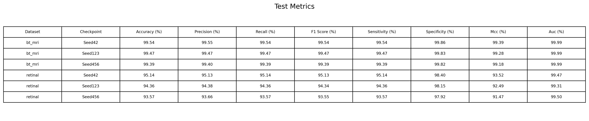

# BiFormer-GAM for Medical Image Classification

PyTorch implementation of a medical image classifier evaluated on retinal
fundus images and brain-tumor MRI. The network uses a BiFormer encoder,
parallel DenseNet121 and EfficientNet-B0 backbones, GAM feature fusion,
global average pooling, and a GELU MLP classifier.

This release intentionally contains only the architecture used by the supplied
experiments. Alternative ResNet, EfficientNet-B1, concatenation, gated,
cross-attention, and ReLU-MLP implementations were removed to keep the codebase
small and unambiguous.

## Architecture

```text
Input image [B, 3, 224, 224]
  -> BiFormer encoder (4 blocks, patch size 4, n_win 7, top-k 4)
  -> reconstructed image [B, 3, 224, 224]
  -> DenseNet121 [B, 1024, 7, 7]
     + EfficientNet-B0 [B, 1280, 7, 7]
  -> concatenate [B, 2304, 7, 7]
  -> GAM channel attention
  -> GAM spatial attention
  -> 1x1 Conv + BatchNorm + ReLU [B, 768, 7, 7]
  -> tokens [B, 49, 768]
  -> global average pooling [B, 768]
  -> MLP: 768 -> 1024 -> 512 -> number of classes
```

## Repository structure

```text
.
|-- train.py
|-- evaluate.py
|-- explain.py
|-- visualize_intermediate_feature_maps.py
|-- split_data.py
|-- requirements.txt
|-- configs/
|-- data/
|-- model/
|-- results/
|-- utils/
`-- third_party/BiFormer/
```

Datasets, checkpoints, raw training outputs, archives, and Python cache files
are excluded through `.gitignore`. Curated evaluation and explainability
figures in `results/` are tracked.

## Datasets

### Retinal

- Source: https://www.kaggle.com/datasets/gunavenkatdoddi/eye-diseases-classification
- Classes: cataract, diabetic retinopathy, glaucoma, normal
- Split used here: 70% train, 15% validation, 15% test
- Related source/patient images identified by the filename convention remain
  in the same split.

### BT-MRI

- Source: https://www.kaggle.com/datasets/masoudnickparvar/brain-tumor-mri-dataset/versions/1
- Classes: glioma, meningioma, no tumor, pituitary
- The official Testing folder remains unchanged.
- The original Training folder is divided into 80% train and 20% validation.

Do not commit the downloaded datasets to this repository.

## Installation

```bash
python -m pip install -r requirements.txt
```

The code was designed for Python, PyTorch, and CUDA environments supported by
the versions declared in `requirements.txt`.

## Data preparation

Retinal:

```bash
python split_data.py \
  --dataset retinal \
  --source raw_data/retinal/dataset \
  --output datasets/retinal \
  --seed 4242
```

BT-MRI:

```bash
python split_data.py \
  --dataset bt_mri \
  --source raw_data/bt_mri \
  --output datasets/bt_mri \
  --seed 142
```

Expected layout:

```text
datasets/<dataset>/
|-- train/<class names>/
|-- val/<class names>/
`-- test/<class names>/
```

## Training

Six reproducible experiment configurations are stored in `configs/`.

```bash
python train.py --config configs/retinal_seed42.json
python train.py --config configs/retinal_seed123.json
python train.py --config configs/retinal_seed456.json

python train.py --config configs/bt_mri_seed42.json
python train.py --config configs/bt_mri_seed123.json
python train.py --config configs/bt_mri_seed456.json
```

For Colab data copied to local runtime storage, override the path without
editing source code:

```bash
python train.py \
  --config configs/retinal_seed42.json \
  --data-root /content/datasets/retinal
```

Each run writes:

```text
outputs/<dataset>/<run_name>/
|-- checkpoints/
|   |-- best_accuracy.pt
|   |-- best_loss.pt
|   `-- last.pt
`-- results/
    |-- metrics_best_accuracy.json
    `-- metrics_best_loss.json
```

Training automatically resumes from `last.pt`. Pass `--no-resume` to start a
new run in an empty output directory. The last checkpoint is updated every 25
epochs; best-loss and best-accuracy checkpoints are updated whenever the
validation result improves.

## Evaluation

Evaluation reports Accuracy, Precision, Recall, F1-score, Sensitivity,
Specificity, MCC, and micro-average AUC. It also generates a confusion matrix,
ROC curves, and precision-recall curves.

```bash
python evaluate.py \
  --config configs/retinal_seed42.json \
  --checkpoint outputs/retinal/gam_cosine300_seed42/checkpoints/best_accuracy.pt
```

To evaluate an existing checkpoint while the dataset is in Colab storage:

```bash
python evaluate.py \
  --config configs/retinal_seed42.json \
  --checkpoint /path/to/checkpoint.pt \
  --data-root /content/datasets/retinal
```

## Reported results

The included results were produced from the best-validation-accuracy
checkpoint for each run. Metrics are percentages.

| Dataset | Seed | Accuracy | Precision | Recall | F1-score | Sensitivity | Specificity | MCC | AUC |
|---|---:|---:|---:|---:|---:|---:|---:|---:|---:|
| BT-MRI | 42 | 99.5423 | 99.5455 | 99.5423 | 99.5418 | 99.5423 | 99.8618 | 99.3873 | 99.9947 |
| BT-MRI | 123 | 99.4661 | 99.4668 | 99.4661 | 99.4660 | 99.4661 | 99.8283 | 99.2839 | 99.9875 |
| BT-MRI | 456 | 99.3898 | 99.3981 | 99.3898 | 99.3898 | 99.3898 | 99.8154 | 99.1839 | 99.9950 |
| Retinal | 42 | 95.1411 | 95.1267 | 95.1411 | 95.1251 | 95.1411 | 98.4009 | 93.5245 | 99.4711 |
| Retinal | 123 | 94.3574 | 94.3823 | 94.3574 | 94.3392 | 94.3574 | 98.1550 | 92.4949 | 99.3067 |
| Retinal | 456 | 93.5737 | 93.6584 | 93.5737 | 93.5477 | 93.5737 | 97.9236 | 91.4750 | 99.5019 |

The combined CSV and table cover all six runs. Detailed JSON reports,
confusion matrices, ROC/precision-recall curves for seed 42, feature maps,
Grad-CAM, Grad-CAM++, and t-SNE figures are available in
[`results/`](results/).



## Explainability

`explain.py` creates:

- Grad-CAM and Grad-CAM++ at `model.fusion.output_projection`
- t-SNE from the 768-dimensional feature vector after global average pooling
- a combined vertical comparison for BT-MRI and retinal images

```bash
python explain.py \
  --bt-mri-config configs/bt_mri_seed42.json \
  --bt-mri-checkpoint /path/to/bt_mri_best_accuracy.pt \
  --bt-mri-data-root /content/datasets/bt_mri \
  --retinal-config configs/retinal_seed42.json \
  --retinal-checkpoint /path/to/retinal_best_accuracy.pt \
  --retinal-data-root /content/datasets/retinal \
  --output-dir outputs/xai
```

## Intermediate feature maps

`visualize_intermediate_feature_maps.py` visualizes BiFormer blocks 2 and 4,
intermediate and final DenseNet121/EfficientNet-B0 features, and the GAM output
projection.

```bash
python visualize_intermediate_feature_maps.py \
  --bt-mri-config configs/bt_mri_seed42.json \
  --bt-mri-checkpoint /path/to/bt_mri_best_accuracy.pt \
  --bt-mri-data-root /content/datasets/bt_mri \
  --retinal-config configs/retinal_seed42.json \
  --retinal-checkpoint /path/to/retinal_best_accuracy.pt \
  --retinal-data-root /content/datasets/retinal
```

The default output directory is `results/intermediate_feature_maps/`.

## Reproducibility

- Experiment seeds: 42, 123, and 456
- DataLoader workers: 0 in the supplied configurations
- cuDNN benchmark disabled
- deterministic cuDNN enabled
- TF32 disabled
- RNG states and DataLoader generator state are stored in `last.pt`

Exact results can still vary across PyTorch, CUDA, cuDNN, driver, and GPU
versions. Record the runtime versions when reporting an experiment.

## Third-party code

The repository vendors BiFormer source code. Preserve
`third_party/BiFormer/LICENSE` and see `THIRD_PARTY_NOTICES.md` for attribution.

Before publishing, choose and add a license for the original code in this
repository. The third-party BiFormer license does not automatically license the
rest of this project.
